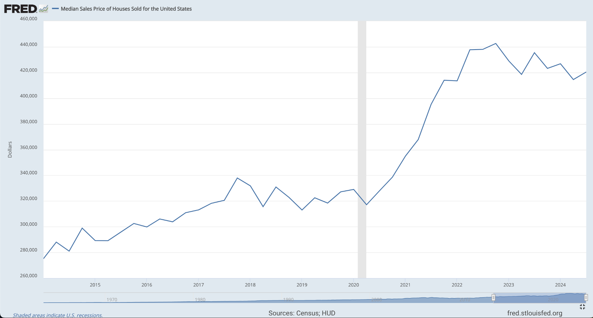

> **Portfolio revision of a November 2024 project.** This version retains the original dataset, exploratory questions, and ETS approach, but updates the data preparation, forecast dating, and evaluation. The original submitted `.Rmd` was preserved separately.

## Overview

This analysis explores how average reported prices differ across U.S. geographic regions and the dataset's `Single` and `Double` home-size categories, how median household income relates to prices, and how prices changed between the pre-2020 period and 2020–2021. A simple exponential-smoothing forecast illustrates what can be learned from the historical series.

The dataset labels its categories `Single`, `Double`, and `Total1`; no more specific bedroom-count interpretation is assumed. Comparisons across periods are descriptive, not evidence that the pandemic *caused* any observed change.

```{r setup, message=FALSE, warning=FALSE}
library(tidyverse)
library(lubridate)
library(forecast)
library(knitr)
knitr::opts_chunk$set(echo = TRUE, message = FALSE, warning = FALSE)
```

## Data and preparation

```{r data-prep}
raw_data <- read.csv("RealEstateUnitedStates.csv", check.names = FALSE)

expected_columns <- c(
  "Year", "Month", "Region", "Home Size", "Average Sales Price",
  "Number of Households (Thousands)",
  "Median Income - Current Dollars", "Median Income - 2022 Dollars",
  "Mean Income - Current Dollars", "Mean Income - 2022 Dollars"
)
stopifnot(identical(names(raw_data), expected_columns))

names(raw_data) <- c(
  "Year", "Month", "Region", "Home_Size", "Avg_Price",
  "Households_Thousands", "Median_Income", "Median_Income_2022",
  "Mean_Income", "Mean_Income_2022"
)

analysis_data <- raw_data %>%
  mutate(
    Home_Size = trimws(Home_Size),
    Date = make_date(Year, match(Month, month.name), 1)
  ) %>%
  filter(Home_Size %in% c("Single", "Double")) %>%
  filter(!is.na(Date), !is.na(Avg_Price), !is.na(Median_Income)) %>%
  distinct() %>%
  mutate(
    Price_Thousands = Avg_Price / 1000,
    Median_Income_Thousands = Median_Income / 1000,
    Households_Millions = Households_Thousands / 1000
  )

stopifnot(nrow(analysis_data) > 0)

summary_table <- tibble(
  Measure = c("Raw records", "Retained records", "Regions", "Unique observed months"),
  Value = c(nrow(raw_data), nrow(analysis_data),
            n_distinct(analysis_data$Region), n_distinct(analysis_data$Date))
)
knitr::kable(summary_table, caption = "Dataset summary")
```

**Units:** Price and income columns in the source file are in dollars and are rescaled to thousands of dollars for plots. The household-count column is **already in thousands** and is divided by 1,000 only to express millions of households.

### Missing months

```{r missing-months}
all_months <- tibble(Date = seq.Date(as.Date("2014-01-01"),
                                    as.Date("2022-12-01"), by = "month"))
observed_months <- analysis_data %>% distinct(Date)
missing_months <- anti_join(all_months, observed_months, by = "Date")
knitr::kable(missing_months, caption = "Months entirely absent from the source data")
```

The time series will be explicitly filled to a regular monthly index before forecasting. Missing months are interpolated for the *forecasting exercise only*; original observations are unchanged.

## Average prices by region and category

```{r regional-price-plot, fig.width=9, fig.height=5}
regional_prices <- analysis_data %>%
  group_by(Region, Home_Size) %>%
  summarise(Mean_Price = mean(Price_Thousands), .groups = "drop")

ggplot(regional_prices, aes(x = Region, y = Mean_Price, fill = Home_Size)) +
  geom_col(position = "dodge") +
  labs(
    title = "Average Reported Price by Region and Home-Size Category",
    x = NULL, y = "Average price (thousands of USD)", fill = "Category"
  ) +
  theme_minimal() +
  theme(axis.text.x = element_text(angle = 20, hjust = 1))
```

This chart compares the dataset's two named categories; it does not establish that they correspond to particular bedroom counts or property types.

## Household income and reported prices

```{r income-price-plot, fig.width=9, fig.height=6}
ggplot(analysis_data,
       aes(x = Median_Income_Thousands, y = Price_Thousands, color = Home_Size)) +
  geom_point(alpha = 0.25) +
  geom_smooth(method = "lm", se = FALSE) +
  facet_wrap(~ Region) +
  labs(
    title = "Median Household Income versus Reported Average Price",
    x = "Median household income (thousands of USD)",
    y = "Average price (thousands of USD)", color = "Category"
  ) +
  theme_minimal()
```

**Interpretation caveat:** Income is recorded for a region and year, while prices vary by month and category. Repeated income values should not be interpreted as independent monthly measurements. Trend lines are descriptive and are not causal estimates.

## Price trends over time

```{r time-series-plot, fig.width=10, fig.height=7}
region_month <- analysis_data %>%
  group_by(Region, Date) %>%
  summarise(Mean_Price = mean(Price_Thousands), .groups = "drop")

ggplot(region_month, aes(x = Date, y = Mean_Price)) +
  geom_line(color = "steelblue", linewidth = 0.55) +
  facet_wrap(~ Region, scales = "free_y") +
  labs(title = "Monthly Average Reported Price by Region",
       x = "Year", y = "Average price (thousands of USD)") +
  theme_minimal()
```

## Before-2020 versus 2020–2021 comparisons

```{r covid-comparison}
period_summary <- analysis_data %>%
  mutate(Period = case_when(
    Date < as.Date("2020-01-01") ~ "Pre_2020",
    Date >= as.Date("2020-01-01") & Date <= as.Date("2021-12-31") ~ "Y2020_2021",
    TRUE ~ NA_character_
  )) %>%
  filter(!is.na(Period)) %>%
  group_by(Region, Period) %>%
  summarise(
    Avg_Price = mean(Price_Thousands),
    Median_Income = mean(Median_Income_Thousands),
    .groups = "drop"
  ) %>%
  pivot_wider(names_from = Period,
              values_from = c(Avg_Price, Median_Income)) %>%
  mutate(
    Price_Change_Pct = 100 *
      (Avg_Price_Y2020_2021 / Avg_Price_Pre_2020 - 1),
    Income_Change_Pct = 100 *
      (Median_Income_Y2020_2021 / Median_Income_Pre_2020 - 1)
  )

knitr::kable(period_summary %>%
               select(Region, Price_Change_Pct, Income_Change_Pct) %>%
               mutate(across(where(is.numeric), ~ round(.x, 1))),
             caption = "Change in period means (%)")
```

```{r covid-plot, fig.width=9, fig.height=5}
period_summary %>%
  select(Region, Price_Change_Pct, Income_Change_Pct) %>%
  pivot_longer(-Region, names_to = "Measure", values_to = "Change") %>%
  ggplot(aes(x = Region, y = Change, fill = Measure)) +
  geom_col(position = "dodge") +
  labs(title = "Differences in Period Averages", x = NULL,
       y = "Percent change (%)", fill = "Measure") +
  theme_minimal() +
  theme(axis.text.x = element_text(angle = 20, hjust = 1))
```

Because these are different-length historical periods, these differences include longer-run trends and other factors; the analysis does not identify the causal effect of COVID-19.

## Monthly forecast and out-of-sample evaluation

The original project forecast a decomposed trend. For this portfolio revision, a regular monthly national series is modeled directly using **ETS(A,A,N)**: additive errors, additive trend, and no seasonal component. This avoids accidentally dating the forecasts earlier than 2023 when a centered trend is truncated near the end of the observed period.

```{r regular-series}
national_month <- analysis_data %>%
  filter(Region == "United States") %>%
  group_by(Date) %>%
  summarise(Price = mean(Price_Thousands), .groups = "drop") %>%
  complete(Date = seq.Date(as.Date("2014-01-01"),
                           as.Date("2022-12-01"), by = "month")) %>%
  arrange(Date)

# Missing monthly slots stay explicitly missing until imputation.
monthly_ts <- ts(national_month$Price, start = c(2014, 1), frequency = 12)
train_ts <- window(monthly_ts, end = c(2021, 12))
test_ts  <- window(monthly_ts, start = c(2022, 1))
stopifnot(length(test_ts) == 12, !anyNA(test_ts))

# Interpolate the training period using training information only.
train_filled <- forecast::na.interp(train_ts)
validation_model <- forecast::ets(train_filled, model = "AAN")
validation_forecast <- forecast::forecast(validation_model, h = 12)

actual <- as.numeric(test_ts)
predicted <- as.numeric(validation_forecast$mean)
validation_results <- tibble(
  Metric = c("2022 holdout MAE (thousand USD)",
             "2022 holdout RMSE (thousand USD)"),
  Value = c(mean(abs(actual - predicted)),
            sqrt(mean((actual - predicted)^2)))
)
knitr::kable(validation_results %>% mutate(Value = round(Value, 2)),
             caption = "Out-of-sample 2022 forecast error")
```

```{r holdout-plot, fig.width=9, fig.height=5}
validation_plot <- tibble(
  Date = seq.Date(as.Date("2022-01-01"), by = "month", length.out = 12),
  Actual = actual,
  Predicted = predicted
) %>%
  pivot_longer(c(Actual, Predicted), names_to = "Series", values_to = "Price")

ggplot(validation_plot, aes(x = Date, y = Price, color = Series)) +
  geom_line(linewidth = 1) +
  geom_point(size = 1.4) +
  labs(title = "Held-Out 2022: Observed versus Forecast",
       x = NULL, y = "Average price (thousands of USD)") +
  theme_minimal()
```

### Illustrative forecast for January–December 2023

```{r future-forecast, fig.width=9, fig.height=5}
# Fit on all of 2014–2022 after filling the three missing dates.
full_ts <- forecast::na.interp(monthly_ts)
final_model <- forecast::ets(full_ts, model = "AAN")
forecast_2023 <- forecast::forecast(final_model, h = 12)

autoplot(forecast_2023) +
  labs(title = "Illustrative ETS Forecast for 2023",
       x = "Year", y = "Average price (thousands of USD)") +
  theme_minimal()
```

The 2023 forecast illustrates the method; forecasting error should be judged by the held-out 2022 results above, not by fitted historical residuals. The forecast is not a claim about current or future house prices.

## FRED national median sale-price series (context only)



**Not a like-for-like validation:** FRED's chart concerns the *median sales price of houses sold* nationwide. The dataset analyzed above reports an *average price* separately for its `Single` and `Double` categories. Differences in definitions and population make numeric forecast comparisons inappropriate. The image is included for broader housing-market context only.

## Conclusion and limitations

The project demonstrates reproducible R-based data preparation, regional visualization, descriptive period comparisons, and a forecast with an explicit historical holdout. The time-series dataset is missing three entire months, which were interpolated only for forecasting. Results remain sensitive to how the two price categories were defined and how the source data was assembled. Further analysis should verify original variable definitions, test additional model families, and use explicitly comparable benchmark price series.

## References

- Federal Reserve Bank of St. Louis, [Median Sales Price of Houses Sold for the United States (MSPUS)](https://fred.stlouisfed.org/series/MSPUS), sourced from U.S. Census Bureau and HUD.
- Original data file: `RealEstateUnitedStates.csv` (provided with the November 2024 project). Please verify the original dataset publisher and redistribution license before publicly reposting the CSV.
